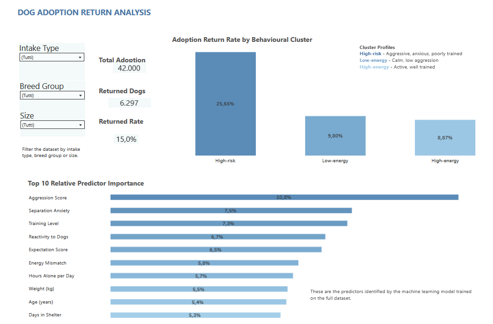

# Dog Adoption Return Prediction
Predicting unsuccessful dog adoptions using exploratory data analysis, clustering, survival analysis and machine learning.

# Project Overview
This project aims to investigate the key features affecting the **unsuccessful dog adoptions**. It focuses on physical dog characteristics (e.g. size, weight, age, medical needs), behavioural traits like aggression, separation anxiety, reactivity to other dogs, and adopter characteristics (e.g. expectations, lifestyle factors, home type).

To investigate these factors, the project combines exploratory data analysis, clustering techniques, survival analysis and machine learning models.

# Dataset
A synthetic dataset published on [Kaggle](https://www.kaggle.com/datasets/sergionefedov/dog-adoption-success-does-the-match-last) containing 42,000 dog adoptions, 30 features and a 15% return rate. 

It was designed to simulate realistic adoption scenarios and predict whether an adopted dog will be returned to the shelter. 

The dataset includes the following feature categories:
- Dog characteristics
- Behavioural assessments
- Adopter characteristics
- Adoption-related variables
- Target variable (returned)

**Note**: This dataset is fully synthetic and was generated for educational purposes. It models post-adoption outcomes, a topic for which publicly available real-world datasets are limited.

# Objectives
The main objectives of this project are to:
- Compare the model based on dog characteristics with the one based on adopter characteristics
- Identify the factors that most influence returns to the shelter
- Evaluate the effects of interventions (e.g. counselling, visits, meet-and-greets with resident pets)
- Compare the return times between behavioural causes and life-circumstance-related causes
- Develop a Match Score to estimate the risk of a dog-adopter match

# Methods
- Data Exploration & Cleaning
- Exploratory Data Analysis (EDA)
- Behavioural Clustering (K-Means)
- Predictive Modeling (Random Forest and Logistic Regression)
- Survival Analysis (Kaplan-Meier estimator and Log-rank test)
- Match Score Development

# Interactive Dashboard
[Explore the interactive Tableau dashboard](https://public.tableau.com/views/DashboardDogAdoption/Dashboard1?:language=it-IT&publish=yes&:sid=&:redirect=auth&:display_count=n&:origin=viz_share_link)

### Dashboard Preview

# Results
Three behavioural clusters were identified using K-Means clustering. Cluster profiling showed that one cluster was characterized by higher aggression, separation anxiety and reactivity scores, together with a lower training level, representing the highest behavioural risk profile. Cluster membership was associated with different return probabilities, while the Logistic Regression identified dog aggression as the behavioural trait with the highest positive coefficient.

The predictive model based on the dog traits performed better than the one based on the adopter characteristics (ROC-AUC 0.70 vs 0.51). Unfortunately, both models showed a limited predictive ability on returned dogs.

The third model, based only on different interventions, highlighted the pre-adoption visits as the most influential factor on return probability, followed by counselling and meet-and-greets with resident pets. 

Survival analysis showed a statistically significant difference between behavioural-related returns and life-circumstance-related returns. Dogs returned for behavioural reasons tended to be returned earlier after adoption.

Finally the complete model, covering all the features of the dataset, achieved the best predictive performance (ROC-AUC 0.73) and was used to calculate a Match Score based mainly on the dog aggression, followed by several additional behavioural and adoption-related features.

# Technologies Used
- Python
- pandas
- NumPy
- Matplotlib
- Seaborn
- scikit-learn
- lifelines
- Jupyter Notebook

# How to Run
1) Clone the repository.
2) Install the required libraries.
3) Place `dog_adoption_master.csv` in the project folder.
4) Open `DogAdoption.ipynb`.
5) Run all cells.